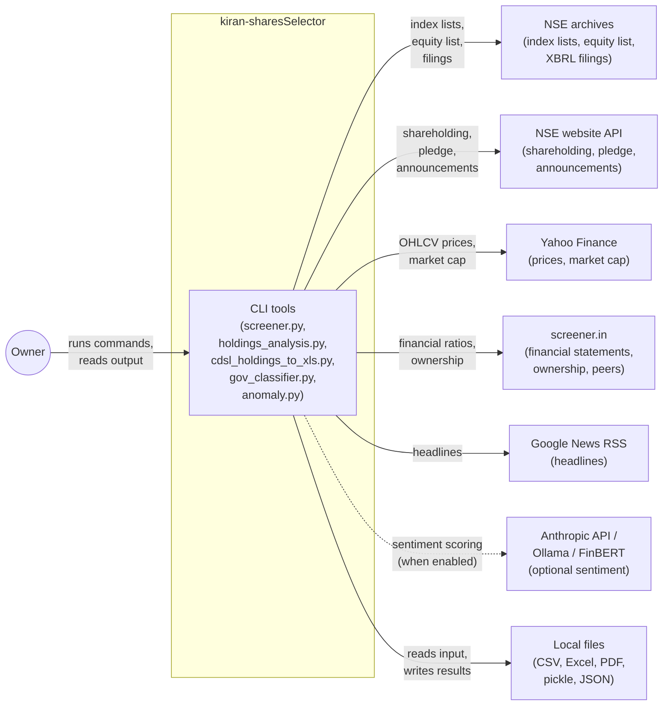
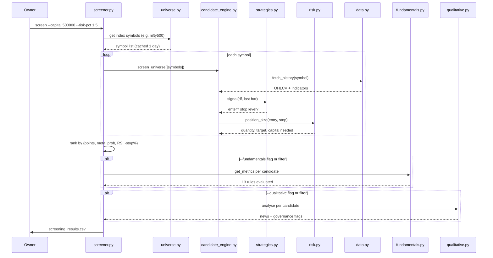

# Overview

Audience: anyone joining this project who needs to understand what the repository does, what it talks to, and how the pieces fit together.

Evidence: 16 of 16 entry points read · 11 capabilities · 8 open unknowns relevant to this document · commit b472b9b · Surveyor 2.2.0 · 2026-10-24

---

## What the project does and for whom

This is a set of Python command-line tools for one person (the repository owner) who swing-trades shares on India's National Stock Exchange (NSE). The tools screen the market for shares that meet rule-based entry conditions, size the position to a risk budget, backtest the rules on historical data, validate whether a backtest result is luck, monitor open positions, and analyse the owner's existing holdings against the same rules [S01/F001, S03/F005, S04/F008, S06/F002, S07/F003].

The repository is a flat folder of 35 Python files (about 9,550 lines), with no package metadata, no web server, no scheduler and no CI pipeline [inventory]. The owner runs each tool by hand from a terminal on their own computer [inventory: all entry points are CLI commands].

The tools do not place or close trades. They produce a ranked list, a report or a verdict, and the owner decides what to do [S01/F001: `screener.py:357`; S03/F005: `cmd_monitor` writes no file, prints only; doc-diff P1].

---

## Capabilities

| ID | Name | Importance | Entry points | Test result | Slice |
|---|---|---|---|---|---|
| C01 | Screen and rank candidate trades | High | `screener.py screen` | tested on the surface (core); unknown (enrichment) | S01, S02 |
| C02 | Monitor an open position | High | `screener.py monitor` | tested on the surface | S03 |
| C03 | Analyse existing holdings | High | `holdings_analysis.py` | not tested | S04 |
| C04 | Convert a CDSL account statement to Excel | Medium | `cdsl_holdings_to_xls.py` | not tested | S05 |
| C05 | Backtest the trading rules on history | Medium | `screener.py backtest` | well tested | S06 |
| C06 | Validate a backtest (is the result luck?) | Medium | `screener.py validate`, `real_data_check.py` | well tested (F003); not tested (F013) | S07 |
| C07 | Check companies for red flags | Medium | `gov_classifier.py train/import-sheet/predict`, `anomaly.py` | well tested (classifier TF-IDF, anomaly); tested on the surface (import-sheet, predict) | S08 |
| C08 | Filter trades by predicted quality (meta-model) | Low | `screener.py train-meta` | well tested | S09 |
| C09 | Rebuild index membership history | Low | `screener.py snapshot-changes` | well tested | S10 |
| C10 | Refresh prices in a results file | Low | `screener.py update-price` | not tested | S10 |
| C11 | Diagnose data-source problems | Low | `diagnose_dump.py`, `fetch_xbrl_sample.py` | not tested | S11 |

Importance ratings are inferred from what each tool does to real money or personal data. No person has stated them. [capabilities.md]

The three High-importance capabilities (C01, C02, C03) together cover the owner's daily workflow: find new candidates, check open positions, and review the portfolio.

---

## System context diagram

The owner runs every tool from a terminal. External data comes from five web services and one optional AI service. All results stay in local files.

Every node maps to an integration in the inventory [inventory: I001-I009]. The Anthropic/Ollama/FinBERT connection is dashed because it is optional and off by default (`screener.py:790`, `--qualitative` default `off`) [S02/F001].

---

## High-level architecture diagram

All 35 Python files sit in one flat folder. There are no packages, no sub-folders for code, and no framework [inventory]. The diagram groups files by role.

```mermaid
graph TD
    subgraph "CLI entry points"
        SCR["screener.py<br/>(7 sub-commands)"]
        HA["holdings_analysis.py"]
        CDSL["cdsl_holdings_to_xls.py"]
        GOV["gov_classifier.py<br/>(3 sub-commands)"]
        ANOM_CLI["anomaly.py<br/>(standalone)"]
        DIAG["diagnose_dump.py"]
        FETCH["fetch_xbrl_sample.py"]
    end

    subgraph "Screening and ranking"
        CE["candidate_engine.py"]
        STRAT["strategies.py"]
        RISK["risk.py"]
        FILT["filters.py"]
        MKT["market.py"]
    end

    subgraph "Data sources"
        DATA["data.py<br/>(Yahoo prices)"]
        UNIV["universe.py<br/>(NSE index lists)"]
        FUND["fundamentals.py"]
        OWN["ownership.py"]
        FW["fund_weights.py"]
        SI["screener_in.py"]
        NSE_CL["nse_client.py"]
        QUAL["qualitative.py"]
    end

    subgraph "Backtesting and validation"
        BT["backtester.py"]
        COST["costs.py"]
        EXIT["exits.py"]
        VAL["validation.py"]
        RPT["report.py"]
        RDC["real_data_check.py"]
    end

    subgraph "ML and flags"
        META["meta_model.py"]
        GOVC["gov_classifier.py<br/>(as library)"]
        ANOM["anomaly.py<br/>(as library)"]
    end

    subgraph "Position management"
        MON["monitor.py"]
    end

    SCR --> CE
    SCR --> BT
    SCR --> VAL
    SCR --> MON
    SCR --> META
    CE --> STRAT
    CE --> RISK
    CE --> FILT
    CE --> DATA
    CE --> UNIV
    CE --> MKT
    SCR --> FUND
    SCR --> QUAL
    SCR --> ANOM
    FUND --> SI
    FUND --> OWN
    OWN --> NSE_CL
    BT --> STRAT
    BT --> EXIT
    BT --> COST
    BT --> DATA
    VAL --> BT
    VAL --> RPT
    MON --> EXIT
    MON --> STRAT
    MON --> DATA
    HA --> FUND
    HA --> FW
    HA --> QUAL
    HA --> ANOM
    HA --> STRAT
    HA --> DATA
    HA --> UNIV
```

Every node is a file in the repository [inventory, capabilities.md]. Arrows show import dependencies found in the slices [S01-S11]. Files not shown: the 6 test scripts (`test_toolkit.py`, `test_membership.py`, `test_ml.py`, `test_screen_enrich.py`, `test_sources.py`, `test_validation.py`), configuration files (`requirements.txt`, `install-commands.txt`, `fundamental_weights.csv`, `index_changes.example.csv`), and documentation files [inventory].

---

## End-to-end flow: screen and rank candidate trades (C01)

C01 is the most important capability. The owner runs `python screener.py screen` with their capital, risk percentage and strategy choice. The tool returns a ranked CSV of shares that meet the rules today [S01/F001].

Steps in detail:

1. **Universe.** `universe.py` downloads the chosen NSE index list (default NIFTY 500) and caches it for one day. If the download fails, the last cached copy is used. If there is no cache, the run stops with exit code 1 [S01/F001: `universe.py:156`, `screener.py:70`].

2. **Signal.** For each symbol, `candidate_engine.py` downloads one year of price history through `data.py` (Yahoo Finance), adds indicator columns, and asks the chosen strategy for a signal on the last bar. The default strategy (`pullback_trend`) requires the close above the 20-day and 50-day moving averages, a rising 50-day average, and a pullback that reclaimed the average today [S01/F001: `strategies.py:194`].

3. **Filters.** The signal must also pass the technical filters: close above the 200-day average (on by default), minimum daily turnover of 1 crore, close within 20% of the 52-week high, and a stop no wider than 8% of the entry price [S01/F001: `strategies.py:37`, `filters.py:93`].

4. **Sizing.** `risk.py` sizes the position so that the loss at the stop equals the chosen percentage of capital (default 1.5%). The target is set at 2 times the stop distance [S01/F001: `risk.py:60`, `risk.py:91`].

5. **Enrichment (optional).** Fundamentals, ownership, anomaly and news checks run only on the survivors, in that order. Each is off by default and turned on with `--fundamentals`, `--anomalies` or `--qualitative`, set to `flag` (annotate) or `filter` (also drop failures). There are 13 fundamental rules (ROCE, ROE, debt-to-equity, interest cover, sales and PAT growth, P/E vs industry, PEG, promoter holding, promoter decline, FII change, DII change, pledge). Banks and lenders are exempt from ROCE, debt-to-equity and interest cover [S02/F001: `fundamentals.py:82`, `fundamentals.py:79`].

6. **Ranking.** Candidates are sorted by total points (including fundamental-rule passes), meta-model probability, relative strength versus the benchmark, and tighter stop percentage [S01/F001: `candidate_engine.py:180`]. Sector concentration is flagged, never removed [S01/F001: `candidate_engine.py:279`].

7. **Output.** The ranked list is written to `screening_results.csv` with a TOTAL row [S01/F001: `screener.py:814`, `screener.py:391`].

One contradiction affects understanding of this flow: the README says candidates are ranked by "score first, then reward:risk", but the code ranks by points, meta-model probability, relative strength and stop tightness. The reward-to-risk ratio sets the target, not the ranking [doc-diff D2, U18].

---

## Unknowns and next probes

These open questions are relevant to the overview. The full list is in `docs/_evidence/open-questions.md`.

| ID | Question | Who can answer |
|---|---|---|
| U02 | `screener.py` passes `min_inst_change` to `FundamentalFilters`, which has `min_fii_change` instead. Does `screen --fundamentals flag` fail? | developer |
| U03 | `fund.industry_pe_map` is called but not defined in any root Python file. Where is it? | developer |
| U07 | `screen` receives the portfolio heat ceiling and max positions but never checks them (only the backtester does). Intended? | product owner |
| U17 | README says "no brokerage, STT, or taxes" and "no slippage", but `costs.py` computes all of these and the backtester applies them by default. Is the README outdated? | developer |
| U18 | README says ranking is "score first, then reward:risk". Code ranks by (points, meta_prob, relative_strength, -stop_pct). Which is current? | developer |
| U19 | README says `fundamentals.py` provides "Yahoo annual-statement ratios". Code tries screener.in first and falls back to Yahoo. Is the README outdated? | developer |
| U20 | README lists 8 fundamental rules. Code defines 13 (5 ownership rules are missing from the README). Is the README incomplete? | developer |
| U21 | The spec names earnings-call processing and BSE APIs. No code implements either. Are these planned features or has the spec drifted? | product owner |

---

## Related documents

- [02-module-architecture.md](02-module-architecture.md): module layout, dependencies and patterns
- [03-request-to-response-flow.md](03-request-to-response-flow.md): one section per capability, with flow diagrams for High-importance capabilities
- [04-screen-and-rank.md](04-screen-and-rank.md): the screening and ranking mechanism in depth (C01)
- [05-api-reference.md](05-api-reference.md): every command and its options
- [09-test-exposure-map.md](09-test-exposure-map.md): test coverage per capability and flow
