# Module architecture

Audience: a developer or analyst joining this project who needs to understand which files do what, how they depend on each other, and where to look when something needs to change.

Evidence: 35 of 35 Python files mapped · 11 capabilities · 5 open unknowns relevant to this document · commit b472b9b · Surveyor 2.2.0 · 2026-10-24

---

## Module layout with responsibilities

The repository is one flat folder of 35 Python files (about 9,550 lines), with no packages, no sub-folders for code, no `__init__.py` and no framework [inventory]. Every file is a module that can be imported or, for the entry points, run from the command line.

The table groups files by role. "Lines" is an approximate count from the inventory. "Imported by" lists the modules that import each file, as traced in slices S01 through S11.

### CLI entry points

These files have `if __name__ == "__main__"` blocks and argument parsers. They wire the supporting modules together.

| File | Lines | Responsibility | Capabilities |
|---|---|---|---|
| `screener.py` | 881 | Central CLI with 7 sub-commands: `screen`, `backtest`, `validate`, `train-meta`, `monitor`, `update-price`, `snapshot-changes`. Parses arguments, orchestrates each command, and writes the output CSV or calls the report builder. | C01, C02, C05, C06, C08, C09, C10 [S01/F001, S03/F005, S06/F002, S07/F003, S09/F004, S10/F006, S10/F007] |
| `holdings_analysis.py` | 473 | Standalone CLI. Reads a holdings workbook, resolves ISINs to NSE symbols, runs each check (trend, fundamentals, news, anomaly), writes an Excel analysis workbook. | C03 [S04/F008] |
| `cdsl_holdings_to_xls.py` | 1,173 | Standalone CLI. Opens a password-protected CDSL PDF, parses stock and mutual-fund tables (text layer or OCR), validates ISIN check digits, cross-checks arithmetic, reconciles totals, writes two Excel files. | C04 [S05/F009] |
| `gov_classifier.py` | 311 | Standalone CLI with 3 sub-commands: `train`, `import-sheet`, `predict`. Trains and applies a governance-flag classifier that demotes likely false positives. Also imported as a library by `qualitative.py`. | C07 [S08/F010, F011, F012] |
| `anomaly.py` | 259 | Standalone CLI and library. Detects financial anomalies from statement ratios, peer z-scores and Isolation Forest. Called from `screen`, the holdings analysis and the command line. | C07 [S08/F014] |
| `real_data_check.py` | 117 | Standalone CLI. Checks connectivity to Yahoo and NSE, then runs `screener.py validate` as a subprocess for each strategy against real data, collecting reports into a dated folder. | C06 [S07/F013] |
| `diagnose_dump.py` | 106 | Standalone script. Summarises a debug-dump folder of screener.in HTML and NSE JSON files, showing what each parser found. Developer aid. | C11 [S11/F015] |
| `fetch_xbrl_sample.py` | 59 | Standalone script. Downloads the latest XBRL shareholding filing from NSE and lists pledge/encumbrance tags. Developer aid. | C11 [S11/F016] |

### Screening and ranking

These modules implement the core screening logic. They have no `__main__` blocks and no argparse.

| File | Lines | Responsibility | Imported by |
|---|---|---|---|
| `candidate_engine.py` | ~300 | Screens a list of symbols: for each, downloads history, asks the strategy for a signal, applies pre-trade filters, sizes the position with the risk engine, and builds a `Candidate`. Ranks candidates by (points, meta-model probability, relative strength, tighter stop). Flags sector concentration. | `screener.py` [S01/F001] |
| `strategies.py` | ~280 | Two pluggable strategies (`pullback_trend` and `breakout`), each with `signal()` for entry and `trend_intact()` for monitoring. Registered in `STRATEGIES` dict. Also holds `TechnicalFilters` (200-day SMA, 52-week high proximity). | `candidate_engine.py`, `backtester.py`, `monitor.py`, `holdings_analysis.py` [S01, S03, S06, S04] |
| `risk.py` | ~100 | Position sizing so the loss at the stop equals a percentage of capital. Target price at a fixed reward-to-risk ratio. Portfolio heat ceiling and `can_add_position` check (used only by the backtester). | `candidate_engine.py`, `backtester.py` [S01, S06] |
| `filters.py` | ~100 | Pre-trade filters: minimum turnover, maximum stop width, results-calendar exclusion. | `candidate_engine.py`, `backtester.py` [S01, S06] |
| `market.py` | ~80 | Benchmark regime detection (bull, bear, caution) and 63-day relative strength. | `candidate_engine.py`, `backtester.py` [S01, S06] |

### Data sources

These modules fetch, parse and cache data from external services and local files.

| File | Lines | Responsibility | Imported by |
|---|---|---|---|
| `data.py` | ~120 | Downloads OHLCV price history from Yahoo Finance via `yfinance`, adds indicator columns. `fetch_history` and `fetch_market_cap_cr` are the two main functions. | `candidate_engine.py`, `backtester.py`, `monitor.py`, `holdings_analysis.py` [S01, S03, S06, S04] |
| `universe.py` | ~170 | Downloads NSE index constituent lists, caches them for one day, saves dated snapshots, diffs snapshots into ADD/REMOVE change rows. | `candidate_engine.py`, `screener.py`, `holdings_analysis.py`, `membership.py` [S01, S04, S10] |
| `fundamentals.py` | 410 | Fetches financial statements from screener.in (primary) with Yahoo as fallback, computes 13 fundamental rules, evaluates pass/fail/n/a per rule. 7-day cache. Banks and lenders are exempt from 3 rules. | `screener.py`, `holdings_analysis.py` [S02, S04] |
| `fund_weights.py` | ~60 | Reads per-rule weights from `fundamental_weights.csv`, scores holdings as Strong/Mixed/Weak. Creates the template file when the CSV is missing. | `holdings_analysis.py` [S04] |
| `screener_in.py` | 424 | Downloads and parses screener.in company pages (P&L, balance sheet, ratios, holdings, growth). 7-day cache, 1.5-second throttle. | `fundamentals.py`, `anomaly.py`, `diagnose_dump.py` [S02, S08, S11] |
| `ownership.py` | ~120 | Promoter holding, pledge, FII and DII changes from NSE filings and screener.in. Never raises; errors become notes. | `fundamentals.py` [S02] |
| `nse_client.py` | 337 | NSE session handling with browser-like headers, rate limiting, retry on 401/403, 7-day cache, debug-dump saving. Parses shareholding, pledge and announcement JSON. | `ownership.py`, `fetch_xbrl_sample.py`, `diagnose_dump.py` [S02, S11] |
| `qualitative.py` | 501 | Google News headline search, keyword sentiment, optional LLM scoring (Ollama, Anthropic or FinBERT), 12 regex red-flag patterns for governance events, optional `GovModel` demotion. 1-day cache. | `screener.py`, `holdings_analysis.py` [S02, S04] |

### Backtesting and validation

These modules simulate and stress-test the trading rules.

| File | Lines | Responsibility | Imported by |
|---|---|---|---|
| `backtester.py` | 360 | Day-by-day historical simulation with no lookahead. Gap-aware exits, equity-based sizing, portfolio heat and position-count enforcement at fill time, statutory costs. Produces `Trade` and `BacktestResult`. | `screener.py` (via `validation.make_runner`) [S06/F002] |
| `costs.py` | 51 | Indian delivery transaction costs: brokerage, STT, exchange and SEBI charges, GST, stamp duty, DP charge, and a 0.1% slippage adjustment. `CostModel.zero()` turns everything off. | `backtester.py` [S06] |
| `exits.py` | 38 | `suggest_stop` (breakeven at +1R, then trail below the recent swing low) and `time_stop_hit` (14 calendar days below 0.5R). Shared by the backtester and the monitor. | `backtester.py`, `monitor.py` [S06, S03] |
| `validation.py` | 429 | Seven stress tests (in/out-of-sample split, calendar year, regime, Monte Carlo, parameter sweep, walk-forward, ablation). `make_runner` builds the `Backtester` with merged parameters. | `screener.py` [S07/F003] |
| `report.py` | 220 | Self-contained HTML validation report: inline SVG charts (equity curve, drawdown, Monte Carlo histogram) and tables. No JavaScript, no external files. | `screener.py` (via `validation`) [S07] |

### ML and flags

| File | Lines | Responsibility | Imported by |
|---|---|---|---|
| `meta_model.py` | 275 | Optional second-stage filter. Trains a HistGradientBoostingClassifier on point-in-time features from closed trades, validated walk-forward, with isotonic or sigmoid calibration. Scores candidates at screen time. | `screener.py`, `candidate_engine.py` [S09/F004, S01] |

### Position management

| File | Lines | Responsibility | Imported by |
|---|---|---|---|
| `monitor.py` | 105 | Checks whether an open position still fits the trend rules. Downloads one year of history, tests trend conditions, applies the exit rules, picks a verdict in a fixed order: stop touched, target touched, trend broken, time-stop, raise stop, hold. | `screener.py` [S03/F005] |

### Membership

| File | Lines | Responsibility | Imported by |
|---|---|---|---|
| `membership.py` | 176 | Reads index-change CSVs, reconstructs point-in-time membership (who was in the index on a given date). Used by the backtester to cut survivorship bias. Appends new change rows idempotently. | `screener.py`, `backtester.py` [S10/F007, S06] |

### Test scripts

Six files, all in the same flat folder. They run as plain scripts with top-level `assert` lines, not `def test_*` functions [inventory]. Whether pytest collects them is unknown (U01).

| File | Assert lines | Targets |
|---|---|---|
| `test_toolkit.py` | 35 | Backtester, candidate engine, costs, filters, risk, strategies, exits [S06] |
| `test_membership.py` | 25 | Index membership and backtester membership checks [S10] |
| `test_ml.py` | 44 | Meta-model, governance classifier, anomaly detector [S08, S09] |
| `test_screen_enrich.py` | 15 | Screen enrichment wiring (but uses options and fields not in this tree; see U04) [S02] |
| `test_sources.py` | 138 | Data-source parsers (but calls a function not in this tree; see U05) [S02] |
| `test_validation.py` | 11 | Validation tools and HTML report [S07] |

### Configuration and data files

| File | Purpose |
|---|---|
| `requirements.txt` | Python package list (pandas, numpy, requests, yfinance, torch, transformers, scikit-learn, openpyxl) [inventory] |
| `install-commands.txt` | Extra install and run commands for the CDSL converter (pdfplumber, xlwt, pytesseract) [inventory] |
| `fundamental_weights.csv` | Per-rule weights for the holdings analysis fundamental score [S04] |
| `index_changes.example.csv` | Example input for index membership changes [inventory] |
| `screening_results.csv` | A results file from a past run [inventory] |

---

## Dependency diagram

Every node is a file in the repository. Arrows mean "imports". The diagram groups files by role, matching the table above. Test scripts are omitted for readability.

```mermaid
graph TD
    subgraph "CLI entry points"
        SCR["screener.py"]
        HA["holdings_analysis.py"]
        CDSL["cdsl_holdings_to_xls.py"]
        GOV["gov_classifier.py"]
        ANOM_CLI["anomaly.py"]
        RDC["real_data_check.py"]
        DIAG["diagnose_dump.py"]
        FETCH["fetch_xbrl_sample.py"]
    end

    subgraph "Screening and ranking"
        CE["candidate_engine.py"]
        STRAT["strategies.py"]
        RISK["risk.py"]
        FILT["filters.py"]
        MKT["market.py"]
    end

    subgraph "Data sources"
        DATA["data.py"]
        UNIV["universe.py"]
        FUND["fundamentals.py"]
        FW["fund_weights.py"]
        SI["screener_in.py"]
        OWN["ownership.py"]
        NSE["nse_client.py"]
        QUAL["qualitative.py"]
    end

    subgraph "Backtesting and validation"
        BT["backtester.py"]
        COST["costs.py"]
        EXIT["exits.py"]
        VAL["validation.py"]
        RPT["report.py"]
    end

    subgraph "ML and flags"
        META["meta_model.py"]
    end

    subgraph "Position management"
        MON["monitor.py"]
    end

    subgraph "Membership"
        MEM["membership.py"]
    end

    SCR --> CE
    SCR --> BT
    SCR --> VAL
    SCR --> MON
    SCR --> META
    SCR --> FUND
    SCR --> QUAL
    SCR --> ANOM_CLI
    SCR --> UNIV
    SCR --> DATA
    SCR --> MEM

    CE --> STRAT
    CE --> RISK
    CE --> FILT
    CE --> DATA
    CE --> UNIV
    CE --> MKT
    CE --> META

    HA --> FUND
    HA --> FW
    HA --> QUAL
    HA --> ANOM_CLI
    HA --> STRAT
    HA --> DATA
    HA --> UNIV

    FUND --> SI
    FUND --> OWN
    OWN --> NSE
    ANOM_CLI --> SI

    BT --> STRAT
    BT --> EXIT
    BT --> COST
    BT --> DATA
    BT --> RISK
    BT --> FILT
    BT --> MKT
    BT --> MEM
    VAL --> BT
    VAL --> RPT

    MON --> EXIT
    MON --> STRAT
    MON --> DATA

    DIAG --> SI
    DIAG --> NSE
    FETCH --> NSE

    QUAL --> GOV
```

Every arrow was traced from import statements in the slices [S01-S11]. `real_data_check.py` and `cdsl_holdings_to_xls.py` are not shown with import arrows because they have no intra-project imports: `real_data_check.py` runs `screener.py` as a subprocess [S07/F013], and `cdsl_holdings_to_xls.py` uses only standard-library and third-party packages [S05/F009].

---

## Patterns observed

### Flat folder, no package structure

All 35 Python files sit in one directory. There is no `__init__.py`, no `pyproject.toml`, no `setup.py` and no sub-folder for source code [inventory]. Every module imports another by bare name (`import data`, `from strategies import ...`), which works only when the working directory is the repository root. This makes the code simple to run (`python screener.py screen ...`) but prevents installing it as a package or importing it from another directory [S01, S02, inventory].

### Strategy pattern for entry rules

`strategies.py` defines two strategies (`PullbackTrend` and `Breakout`) with the same interface: `signal(df, i)` returns a `Signal` with `enter`, `stop` and `entry` fields, and `trend_intact(df, i)` returns a dict of yes/no conditions. Both are registered in a `STRATEGIES` dict at `strategies.py:278` (checked), and the CLI picks one by name [S01/F001]. Adding a new strategy means writing a class with the same two methods and adding it to the dict.

### Never-raise pattern for enrichment and data fetches

The data-source modules (`ownership.py`, `qualitative.py`, `anomaly.py`, `nse_client.py` for pledge/shareholding) are written so they never raise to the caller. Errors are caught and stored as note strings in the result dict. This lets a `screen` or holdings-analysis run continue even when one source is down, at the cost of silent failures visible only in the notes column of the CSV [S02: `ownership.py:119`, S08: `anomaly.py:222`].

### File-based caching with a time-to-live

Several modules cache HTTP responses in a `.cache/` directory as JSON or text files. Each cache entry has a fixed TTL: 7 days for screener.in statements and NSE filings (`fundamentals.py:43`), 1 day for index lists (`universe.py:156`), 1 day for news (`qualitative.py:40`). The cache is checked by file modification time. There is no cache-invalidation command: the owner deletes `.cache/` or lets files expire [S01, S02].

### Monkeypatching in tests

`test_validation.py` replaces `screener.fetch_history` with a function that returns synthetic data (`test_validation.py:37`, S07). `test_ml.py` replaces `screener_in.get_raw` with a function that returns synthetic statements (`test_ml.py:227`, S08). This lets the tests run without a network, but the replacements must match the real function signatures; when the main code changes and the test's replacement does not, the test passes on wrong assumptions. Two tests (`test_screen_enrich.py`, `test_sources.py`) already show this problem: they reference options and functions that do not exist in the current code [U04, U05].

### Pickle for trained models

The meta-model, the governance classifier and the calibrated-model wrapper are all saved and loaded with `pickle` (`meta_model.py:254`, `gov_classifier.py:201`). This is fast but carries a trusted-input assumption: unpickling executes arbitrary code from the file. Since the owner trains and loads their own models on the same machine, the risk is low, but the files must not be shared from an untrusted source [S08, S09].

---

## Extension points

These are the places where a developer would add a new variant without changing the rest of the code.

| Extension | Where to add | What to do | Evidence |
|---|---|---|---|
| New trading strategy | `strategies.py` | Write a class with `signal(df, i)` and `trend_intact(df, i)`, add it to `STRATEGIES` at `strategies.py:278` | [S01/F001] |
| New fundamental rule | `fundamentals.py` | Add the rule name to `ALL_RULES` at `fundamentals.py:82`, add the threshold as a field on `FundamentalFilters`, and add the evaluation logic in `evaluate` | [S02/F001] |
| New anomaly threshold rule | `anomaly.py` | Add the check in `rule_flags` at `anomaly.py:116` and update `_level` if the rule count thresholds should change | [S08/F014] |
| New data source for enrichment | A new `*.py` file in the root | Follow the never-raise pattern (return a dict with a notes field on error), wire it in `screener.py`'s enrichment section (around `screener.py:229`), and add a `--<name>` argument | [S02/F001] |
| New pre-trade filter | `filters.py` | Add a check in the filter chain and a corresponding skip reason in the backtester's skip dict | [S01/F001, S06/F002] |

---

## Homegrown mechanisms

These are mechanisms the project builds itself instead of using a library or framework.

| Mechanism | File(s) | What it does | Why it matters |
|---|---|---|---|
| File-based HTTP cache | `fundamentals.py`, `qualitative.py`, `nse_client.py`, `universe.py` | Stores HTTP responses as files in `.cache/` with a TTL checked by modification time. Each module implements its own variant. | There is no shared caching layer. A change to the cache format or directory must be made in each file separately [S01, S02]. |
| ISIN check-digit validator and OCR look-alike repair | `cdsl_holdings_to_xls.py` | Validates the Luhn-like ISIN check digit (`cdsl_holdings_to_xls.py:159`) and, when OCR characters fail it, swaps look-alikes (O and 0, I and 1) if the swap passes (`cdsl_holdings_to_xls.py:103`). | The CDSL converter has no test. If the look-alike table is wrong, holdings are silently misidentified [S05/F009]. |
| CostModel for Indian delivery charges | `costs.py` | Computes brokerage, STT, exchange and SEBI charges, GST, stamp duty, DP charge and slippage from first principles. | The backtester deducts these from every fill. The README contradicts the code by saying "no brokerage, STT, or taxes" (U17) [S06/F002, doc-diff D1]. |
| Point-in-time feature extraction | `meta_model.py` | Builds training features using only bars up to and including the signal day (`meta_model.py:58`), so no future data leaks into the model. | Tests confirm no lookahead (`test_ml.py:97`), but the features are recalculated at screen time, so a mismatch between the training and screening feature code would be silent [S09/F004]. |
| Walk-forward validation | `validation.py`, `meta_model.py` | Trains on trades that had already closed before each test window, then scores the unseen window. Used both for the meta-model verdict and for the parameter-sweep efficiency test. | This is the main guard against overfitting. The correctness of the window boundaries was checked in S07 and S09 (`validation.py:337`, `meta_model.py:189`). |
| NSE session handling with cookie refresh and retry | `nse_client.py` | Creates a `requests.Session` with browser-like headers, fetches the NSE home page for cookies, retries once on 401/403 with a fresh session (`nse_client.py:48`, `nse_client.py:65`). | NSE blocks requests without a session cookie. The diagnostic script `fetch_xbrl_sample.py` bypasses this by calling `_sess().get()` directly, skipping rate limiting and retry [S11/F016]. |
| Test scripts as top-level assert scripts | 6 `test_*.py` files | Tests run as `python test_toolkit.py`, not as pytest test functions. Each file has top-level `assert` lines and prints "... ok" on success. | Whether pytest collects them is unknown (U01). The assert count (268 across 6 files) is the only test metric available [inventory]. |

---

## Unknowns and next probes

| ID | Question | Who can answer |
|---|---|---|
| U01 | The test files have no `def test_*` functions. Does pytest collect and report them, and do they pass? | developer |
| U04 | `test_screen_enrich.py` expects options and fields (`--weights-file`, `fund_passed_w`) that `screener.py` and `candidate_engine.py` do not have. Which is current? | developer |
| U05 | `test_sources.py` calls `parse_peers_fragment`, which `screener_in.py` does not define. Does the test pass? | developer |
| U06 | Root cause of U04 and U05: are some files from an older version while others were updated? `git log` per file would show. | developer |
| U10 | `holdings_analysis.py` opens the converter's `.xls` output with pandas, which needs `xlrd` for old Excel files. `xlrd` is not in `requirements.txt`. Is it installed? | developer |

---

## Related documents

- [01-overview.md](01-overview.md): what the project does, capabilities table, system context and architecture diagrams
- [03-request-to-response-flow.md](03-request-to-response-flow.md): one section per capability, with flow diagrams
- [05-api-reference.md](05-api-reference.md): every command and its options
- [08-developer-onboarding.md](08-developer-onboarding.md): repository layout, prerequisites, how to run and test
