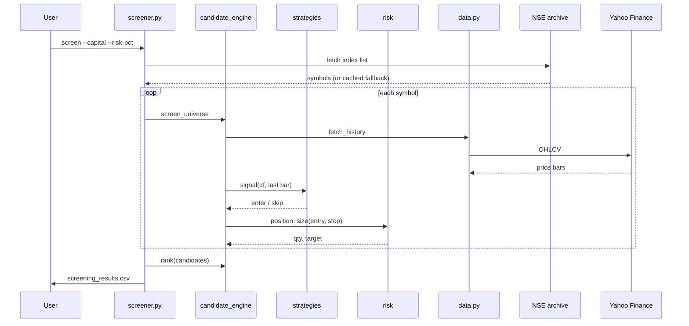
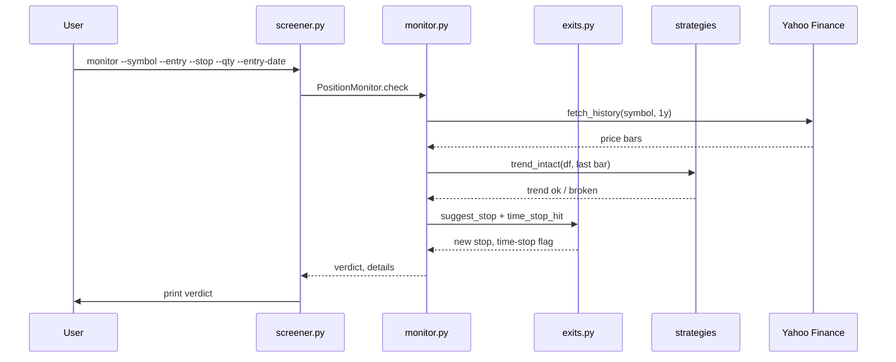
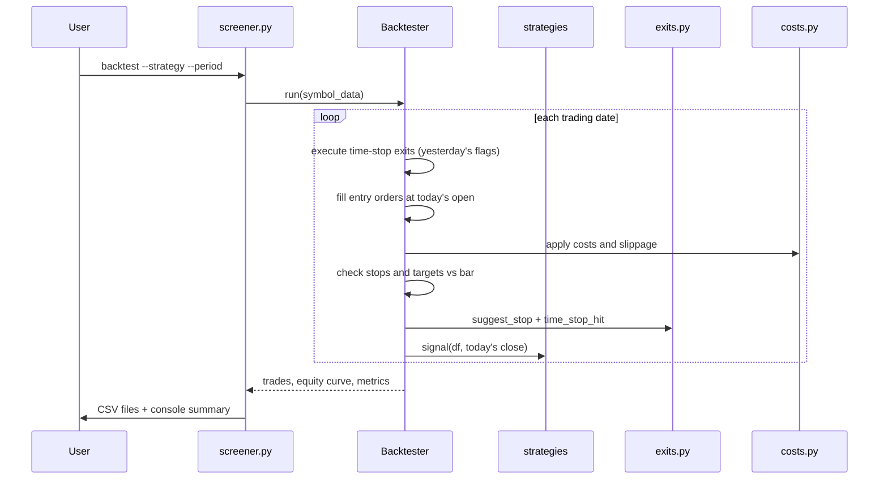

# Request-to-response flow

Audience: a developer or analyst joining this project who needs to understand what each command does, step by step, before changing or extending it.

Evidence: 16 of 16 entry points read · 11 capabilities · 10 open unknowns · commit b472b9b · Surveyor 2.2.0 · 2026-10-24

---

## C01 Screen and rank candidate trades (High)

### Main flow (F001)

Trigger: `python screener.py screen` with strategy, capital, risk and optional enrichment flags [S01/F001].

1. Build the chosen strategy (default `pullback_trend`) and the risk engine with the user's capital, risk percentage and reward-to-risk ratio [S01/F001: `screener.py:335`].
2. Download the index constituent list from NSE and cache it for one day; fall back to the last cached copy if the download fails [S01/F001: `universe.py:156`, `universe.py:162`].
3. For each symbol, download price history from Yahoo Finance [S01/F001: `data.py:50`].
4. Ask the strategy for an entry signal on the last bar. `pullback_trend` needs the close above the 20-day and 50-day averages, the 50-day average rising, and a pullback that reclaims within the lookback window [S01/F001: `strategies.py:194`, `strategies.py:175`]. `breakout` needs the close above the 50-day average, a new-high breakout and strong volume [S01/F001: `strategies.py:261`].
5. Apply the technical filters: close above the 200-day average (on by default), minimum daily turnover, maximum stop width [S01/F001: `strategies.py:37`, `filters.py:93`].
6. Size the position so that the loss at the stop equals the chosen percentage of capital; set the target at a fixed multiple of the stop distance [S01/F001: `risk.py:60`, `risk.py:91`].
7. If enrichment is on (`--fundamentals`, `--anomalies`, `--qualitative`), run the enrichment path (see alternative flows).
8. Rank candidates by total points, then meta-model probability, then relative strength versus the benchmark, then tighter stop [S01/F001: `candidate_engine.py:180`].
9. Flag sector concentration (never remove) [S01/F001: `candidate_engine.py:279`].
10. Write the ranked list to `screening_results.csv` with a TOTAL row [S01/F001: `screener.py:393`, `screener.py:391`].

### Alternative flows

- Enrichment path (`--fundamentals flag` or `filter`): after the technical screen, `get_metrics` fetches annual statements from screener.in first, falls back to Yahoo if that fails, then adds ownership data from NSE filings [S02/F001: `fundamentals.py:277`, `fundamentals.py:284`, `fundamentals.py:296`]. 13 fundamental rules are evaluated (not the 8 in the README, see U20) [S02/F001: `fundamentals.py:82`]. In `filter` mode a failing stock is dropped; in `flag` mode it stays with annotations [S02/F001: `screener.py:248`].
- Anomaly enrichment (`--anomalies flag` or `filter`): `analyse_many` fetches screener.in statements and applies seven threshold rules plus, with enough peers, z-scores and an Isolation Forest [S08/F014: `anomaly.py:207`, `anomaly.py:128`]. In `filter` mode a High-level stock is dropped [S08/F014: `screener.py:268`].
- Qualitative enrichment (`--qualitative flag` or `filter`): scans Google News headlines, applies 12 regex red-flag patterns, optionally scores with a language model (Ollama, Anthropic or FinBERT) and demotes headline-only flags from High to Medium [S02/F001: `qualitative.py:43`, `qualitative.py:129`].
- Meta-model overlay (`--meta filter` or `rank`): loads a pre-trained pickle and adds a calibrated win probability to each candidate; in `filter` mode, drops candidates below the stored threshold [S09/F004: `meta_model.py:272`, `candidate_engine.py:180`].
- `breakout` strategy: same pipeline, different signal (volume breakout above 50-day average) [S01/F001: `strategies.py:261`].

### Exception flows

- A symbol whose history cannot be downloaded is skipped and reported; the run continues [S01/F001: `candidate_engine.py:91`].
- If the index list cannot be downloaded and no cached copy exists, the run exits with code 1 [S01/F001: `screener.py:70`].
- A missing or corrupt meta-model file stops the run with an error message [S01/F001: `screener.py:323`].
- If no candidate meets the rules, a message is printed and no CSV is written, so an older results file stays on disk [S01/F001: `screener.py:357`].
- Enrichment failures never stop the run: screener.in falls back to Yahoo; if both fail, the candidate stays with status n/a; ownership and news code never raises [S02/F001: `fundamentals.py:284`, `fundamentals.py:351`, `ownership.py:119`].

### Business rules

| Rule | Default | Source |
|---|---|---|
| Risk per trade | 1.5% of capital | `screener.py:703` [S01/F001] |
| Target | 2 times the stop distance | `risk.py:91` [S01/F001] |
| Maximum stop width | 8% of entry price | `filters.py:93` [S01/F001] |
| Close above 200-day average | on | `strategies.py:37` [S01/F001] |
| ROCE minimum | 15% | `fundamentals.py:88` [S02/F001] |
| Banks/NBFCs exempt from | ROCE, D/E, ICR | `fundamentals.py:79` [S02/F001] |
| Headline-only flag severity cap | Medium (only NSE filings produce High) | `qualitative.py:129` [S02/F001] |
| Portfolio heat ceiling and max positions | 8% and 5 (passed to the risk engine but not enforced by `screen`, only by the backtester, see U07) | `screener.py:703`, `backtester.py:263` [S01/F001, S06/F002] |

### Test result

Tested on the surface (technical path, S01). Enrichment path (`--fundamentals`, `--anomalies`, `--qualitative`): unknown (S02); see alternative flows above. `test_toolkit.py` checks ranking order, no-lookahead signals, valid stops and pullback-length limits. `test_ml.py` runs `screen` end to end with the meta-model filter. `test_screen_enrich.py` expects options and fields that do not exist in the current code (U04) [S01/F001, S02/F001].

---

## C02 Monitor an open position (High)

### Main flow (F005)

Trigger: `python screener.py monitor --symbol SYM --entry PRICE --stop PRICE --qty N --entry-date DATE` [S03/F005].

1. Build the chosen strategy with no technical filters [S03/F005: `screener.py:625`].
2. Download one year of price history from Yahoo Finance [S03/F005: `monitor.py:54`].
3. Test the strategy's trend conditions on the last bar (for `pullback_trend`: close above 20-day average, close above 50-day average, 50-day average rising) [S03/F005: `monitor.py:69`, `strategies.py:206`].
4. Compute the suggested stop: move to the entry price once the position is up one unit of initial risk, then follow the lowest low of the last 10 bars if that is below the price and above the stop [S03/F005: `exits.py:27`, `exits.py:30`].
5. Check the time-stop: 14 or more calendar days with less than 0.5 units of risk gained [S03/F005: `exits.py:37`].
6. Pick the first verdict that applies, in this order [S03/F005: `monitor.py:84-96`]:

| Priority | Verdict | Condition |
|---|---|---|
| 1 | Should already be closed | Any low since the entry date is at or below the stop |
| 2 | Target already touched | Any high since the entry date reached the target |
| 3 | Trend broken, consider exit | Trend conditions not met |
| 4 | Time-stop triggered | 14+ days and less than 0.5R progress |
| 5 | Raise your stop | The suggested stop is above the current stop |
| 6 | Hold | Nothing triggered |

7. Print the verdict, the suggested stop, the R-multiple and the days held [S03/F005: `screener.py:648`].

### Alternative flows

None. The command does one thing: check a position the user describes. The strategy choice (`--strategy breakout`) changes only the trend conditions.

### Exception flows

- Any error (no data, bad date, network problem) is caught, printed as "Error: ...", and the function returns normally (exit code 0) [S03/F005: `screener.py:635`].

### Business rules

| Rule | Default | Source |
|---|---|---|
| Breakeven trail activation | +1R (one unit of initial risk in profit) | `exits.py:27` [S03/F005] |
| Trailing stop | Lowest low of last 10 bars, if below price and above stop | `exits.py:30` [S03/F005] |
| Time-stop | 14 calendar days with less than 0.5R | `exits.py:37` [S03/F005] |

The "stop already hit" test compares every low since the entry date with the stop the user typed. If the user has already raised the stop, an older bar with a low under the new stop triggers "Should already be closed" (U08) [S03/F005: `monitor.py:66`].

### Test result

Tested on the surface. No test calls `PositionMonitor` or the `monitor` command. The exit rules (`suggest_stop`, `time_stop_hit`) are tested through backtests in `test_toolkit.py` [S03/F005].

---

## C03 Analyse existing holdings (High)

### Main flow (F008)

Trigger: `python holdings_analysis.py <file>` where `<file>` is the `.xls` output of the CDSL converter [S04/F008].

1. Load holdings from the converter's "Holdings" sheet, merging the same ISIN across demat accounts [S04/F008: `holdings_analysis.py:78`].
2. Map each ISIN to an NSE symbol: try the user's `--symbol-map` first, then NSE's equity list, then a built-in table [S04/F008: `holdings_analysis.py:140`]. Funds (ISIN starting INF) and holdings priced at 1.00 are skipped [S04/F008: `holdings_analysis.py:136`, `holdings_analysis.py:138`].
3. For each holding, download price history (`.NS` suffix, then `.BO` fallback) [S04/F008: `holdings_analysis.py:151`].
4. Compute the trend state [S04/F008: `holdings_analysis.py:164-168`]:
   - Intact: close above the 20-day average, the 50-day average, the 200-day average, and the 50-day average is rising.
   - Broken: below the 50-day average and below the 200-day average (or 200-day unknown and 50-day not rising).
   - Weakening: anything else.
5. Compute a suggested stop: the higher of the 20-day low and the 50-day average, if below the current close [S04/F008: `holdings_analysis.py:205`].
6. Run fundamentals (unless `--skip-fundamentals`), news and governance flags, and the anomaly scan [S04/F008: `holdings_analysis.py:298`, `holdings_analysis.py:439`].
7. Add portfolio-level flags: a holding over 25% of portfolio value, a sector over 40%, a position over 5% of daily traded value, a price move of more than 25% since the statement [S04/F008: `holdings_analysis.py:424`, `holdings_analysis.py:425`, `holdings_analysis.py:354`, `holdings_analysis.py:362`].
8. Write `<input>_analysis.xlsx` with sheets Summary, Holdings analysis, Not analysed and Governance flags [S04/F008: `holdings_analysis.py:454`].

### Alternative flows

- `--skip-fundamentals`: skips the fundamental checks [S04/F008: `holdings_analysis.py:298`].
- `--industry-pe`: calls `fund.industry_pe_map`, which is missing from the code (U03) [S04/F008: `holdings_analysis.py:306`].
- CSV fallback: if the Excel writer package (`openpyxl`) is missing, writes a CSV instead [S04/F008: `holdings_analysis.py:463`].
- `--weights-file`: loads per-rule fundamental weights from a CSV and scores each holding as Strong, Mixed or Weak [S04/F008: `holdings_analysis.py:41`].

### Exception flows

- A holding that raises an error during analysis is printed as FAILED and listed on the "Not analysed" sheet; the run continues [S04/F008: `holdings_analysis.py:322`].
- If no holding can be analysed, the run exits with "Nothing could be analysed." [S04/F008: `holdings_analysis.py:437`].
- If the NSE equity list cannot be downloaded, a cached copy or the built-in list is used [S04/F008: `holdings_analysis.py:110`].

### Business rules

| Rule | Default | Source |
|---|---|---|
| Maximum single-holding weight | 25% of portfolio | `holdings_analysis.py:424` [S04/F008] |
| Maximum sector weight | 40% | `holdings_analysis.py:425` [S04/F008] |
| Exit friction flag | Position over 5% of daily traded value | `holdings_analysis.py:354` [S04/F008] |
| Price-move flag | More than 25% since the statement | `holdings_analysis.py:362` [S04/F008] |

### Test result

Not tested. No test imports or runs `holdings_analysis.py`. Search boundary: `holdings_analysis` in all `test_*.py` files at the repository root (no match) [S04/F008].

---

## C04 Convert a CDSL account statement to Excel (Medium)

### Main flow (F009)

Trigger: `python cdsl_holdings_to_xls.py <pdf> --password <PAN>` [S05/F009].

1. Open the PDF with the given password using `pdfplumber` [S05/F009: `cdsl_holdings_to_xls.py:579`].
2. For each page, choose text extraction or OCR: text layer if 50 or more characters, otherwise Tesseract OCR [S05/F009: `cdsl_holdings_to_xls.py:591`].
3. Parse stock holding rows: each ISIN must pass the ISIN check digit, with OCR look-alike correction when it fails [S05/F009: `cdsl_holdings_to_xls.py:159`, `cdsl_holdings_to_xls.py:103`].
4. Cross-check each row: quantity times price must equal value within 0.02 rupees; flag the row otherwise [S05/F009: `cdsl_holdings_to_xls.py:464`].
5. Reconcile: compare the sum per demat account with the printed "Portfolio Value", matching within 0.5 rupees [S05/F009: `cdsl_holdings_to_xls.py:652`].
6. Write `<pdf>_holdings.xls` with sheets Holdings, Reconciliation and (if flagged rows exist) yellow-shaded problem rows [S05/F009: `cdsl_holdings_to_xls.py:1126`, `cdsl_holdings_to_xls.py:954`].
7. Unless `--skip-mf`: extract the mutual fund table from the page where stocks ended, cross-check (three arithmetic checks per row), and write `<pdf>-MF.XLS` [S05/F009: `cdsl_holdings_to_xls.py:1153`, `cdsl_holdings_to_xls.py:793`].

### Alternative flows

- `--skip-mf`: write only the stock file [S05/F009: `cdsl_holdings_to_xls.py:1153`].
- `--force-ocr`: skip the text-layer check and use OCR on every page [S05/F009: `cdsl_holdings_to_xls.py:591`].
- `.xlsx` output: if the output name ends in `.xlsx`, uses `openpyxl` instead of `xlwt` [S05/F009: `cdsl_holdings_to_xls.py:940`].

### Exception flows

- No rows found: exits with advice to try forced OCR, higher resolution or a page range [S05/F009: `cdsl_holdings_to_xls.py:624`].
- Missing `xlwt` or `pytesseract`: exits with an install hint [S05/F009: `cdsl_holdings_to_xls.py:940`].
- No handling for a wrong PDF password: the `pdfplumber.open` call is not wrapped in a try/except (search boundary: `except` in this file finds only `ImportError` handlers) [S05/F009: `cdsl_holdings_to_xls.py:579`].
- An existing output file with the same name is overwritten without warning (search boundary: `os.path.exists` in this file, no match) [S05/F009].

### Business rules

| Rule | Threshold | Source |
|---|---|---|
| ISIN check digit | Luhn on the ISIN's numeric encoding | `cdsl_holdings_to_xls.py:159` [S05/F009] |
| Stock row arithmetic | quantity times price = value, within 0.02 rupees | `cdsl_holdings_to_xls.py:464` [S05/F009] |
| MF row arithmetic | units times NAV = valuation, within max(1.0, 0.05% of value) | `cdsl_holdings_to_xls.py:793` [S05/F009] |
| Total reconciliation | sum within 0.5 rupees of the printed total | `cdsl_holdings_to_xls.py:652` [S05/F009] |
| Text/OCR threshold | 50+ characters on the page = use text layer | `cdsl_holdings_to_xls.py:591` [S05/F009] |

### Test result

Not tested. No test touches this file. Search boundary: `cdsl_holdings|isin_checksum_ok|choose_isin|extract_mf` in all `test_*.py` files at the repository root (no match) [S05/F009].

---

## C05 Backtest the trading rules on history (Medium)

### Main flow (F002)

Trigger: `python screener.py backtest` with strategy, period, capital and risk options [S06/F002].

1. Resolve symbols, set up point-in-time membership (optional `--membership-file`), download price history and the benchmark [S06/F002: `screener.py:406-412`].
2. Build a `Backtester` through `make_runner` [S06/F002: `validation.py:126`].
3. Walk every trading date in order. For each day, in this fixed sequence [S06/F002: `backtester.py:221`]:
   a. Execute time-stop exits flagged yesterday at today's open.
   b. Fill yesterday's entry orders at today's open (best-ranked first).
   c. Check stops and targets against today's bar; gap-aware (if the open is through the stop, fill at the open; if both stop and target fall inside the bar, assume the stop hit first) [S06/F002: `backtester.py:284-289`].
   d. Trail the stop and evaluate the time-stop at the close.
   e. Generate new signals from the close for tomorrow.
4. At fill time, size against current equity, enforce the portfolio heat ceiling (8%) and maximum position count (5) [S06/F002: `backtester.py:253`, `backtester.py:263`].
5. Deduct statutory costs and 0.1% slippage per market fill (delivery brokerage, STT, exchange/SEBI charges, GST, stamp duty, DP charge) [S06/F002: `costs.py:46`]. This contradicts the README's "Known limitations" that says no costs are deducted (U17) [doc-diff D1].
6. Close anything still open at the last bar with reason `end_of_backtest` [S06/F002: `backtester.py:354`].
7. Write `backtest_trades.csv` and `backtest_equity.csv`; print the summary (win rate, profit factor, expectancy, max drawdown, CAGR, fees, exit-reason counts, signals skipped) [S06/F002: `screener.py:436-437`].

### Alternative flows

- `--no-costs`: turns off the cost model [S06/F002: `costs.py`].
- `--no-trailing`: disables the trailing stop; the stop stays at its initial level.
- `--membership-file`: enables point-in-time index membership; signals on stocks not in the index that day are skipped and counted [S06/F002: `backtester.py:263`].
- `breakout` strategy: same loop, different entry signals [S01/F001: `strategies.py:261`].

### Exception flows

- No data fetched: exits with code 1 [S06/F002: `screener.py:410`].
- Per signal, the run counts and skips several reasons without stopping: no bar to fill, gap below stop, max positions reached, zero size or not enough cash, undersized, heat ceiling, not in index, bearish regime, each pre-trade filter reason [S06/F002: `backtester.py:241-264`].

### Business rules

| Rule | Default | Source |
|---|---|---|
| Gap-aware exit | Stop hit at the open when the open is through the stop | `backtester.py:284` [S06/F002] |
| Same-day stop/target conflict | Stop assumed to hit first | `backtester.py:288-289` [S06/F002] |
| Breakeven trail | Activates at +1R | `exits.py:27` [S06/F002] |
| Time-stop | 14 calendar days, less than 0.5R | `exits.py:37` [S06/F002] |
| Heat ceiling | 8% of equity | `backtester.py:263` [S06/F002] |
| Max positions | 5 | `backtester.py:263` [S06/F002] |
| Sizing | Against current equity, not free cash | `backtester.py:253` [S06/F002] |
| Costs | Indian delivery brokerage, STT, exchange, SEBI, GST, stamp, DP + 0.1% slippage | `costs.py:46` [S06/F002] |

### Test result

Well tested. `test_toolkit.py` drives the real `Backtester` over hand-crafted price paths and asserts exit prices, reasons, dates, quantities, cost reconciliation, equity-based sizing, each skip reason, no-lookahead for both strategies and stop modes, and a 12-symbol cash reconciliation. `test_membership.py` checks point-in-time membership [S06/F002].

---

## C06 Validate a backtest (Medium)

### Main flow (F003)

Trigger: `python screener.py validate` with strategy, period, sweep and split options [S07/F003].

1. Run one as-configured backtest through the same runner the backtest command uses [S07/F003: `screener.py:462`].
2. Apply up to seven tests to the result [S07/F003]:

| Test | What it does | Verdict logic |
|---|---|---|
| In-sample vs out-of-sample split | Splits trades by date | "Did not carry over" when out-of-sample avg R is not positive while in-sample is; "material degradation" below half; needs 15+ trades in each half [S07/F003: `validation.py:202-204`] |
| Calendar-year breakdown | Groups trades by year | One row per year showing avg R, net P&L, trade count [S07/F003] |
| Market-regime breakdown | Groups by benchmark trend | One row per regime [S07/F003] |
| Monte Carlo | Shuffles and bootstraps trade order | Drawdown percentiles and chance of finishing below start; needs 20+ trades [S07/F003: `validation.py:362`] |
| Parameter sweep | Runs backtests over a grid | Robust (80%+ profitable sets), mixed (50-80%) or fragile (below 50%); flags inert parameters; refuses above 60 combinations [S07/F003: `validation.py:277`, `validation.py:239`] |
| Walk-forward | Re-optimises per window | Chooses the best training-window set, scores on the next window, reports efficiency [S07/F003: `validation.py:337`] |
| Ablation | Removes one feature at a time | Shows how each component contributes [S07/F003] |

3. Print console tables and plain-English verdicts. With `--report`, write a self-contained HTML file (inline SVG, no JavaScript, no external resources) [S07/F003: `report.py:218`].

### Alternative flow: F013 real-data validation

Trigger: `python real_data_check.py` [S07/F013].

1. Check that Yahoo Finance and the NSE archive are reachable [S07/F013: `real_data_check.py:74`].
2. For each strategy (default both), build a `screener.py validate` command with `--ablation`, `--report` and `--sweep-out`, and run it as a subprocess [S07/F013: `real_data_check.py:88`].
3. Stream the child's output to the console and to `summary_<strategy>.txt` in a dated folder [S07/F013: `real_data_check.py:100`].
4. `--quick` sweeps only `reward_risk`; `--check-only` exits after the connectivity check; `--dry-run` prints the commands without running [S07/F013: `real_data_check.py:42`, `real_data_check.py:83`].

### Exception flows

- Bad `--sweep` or `--split` value: exits with code 1 [S07/F003: `screener.py:458`].
- Too many parameter combinations: refuses with a `ValueError` [S07/F003: `validation.py:239`].
- No equity curve (no usable data): returns early [S07/F003: `screener.py:480`].
- Too few trades for a test: replaces the number with a "too few trades" verdict [S07/F003: `validation.py:199`].
- `real_data_check.py`: exits 1 when Yahoo is unreachable (outside a dry run); reports and skips a strategy whose subprocess fails [S07/F013: `real_data_check.py:80`, `real_data_check.py:106`].

### Test result

F003: well tested. `test_validation.py` runs the whole `validate` command on synthetic data and asserts every HTML section, the absence of scripts and external links, the sweep CSV shape, the no-sweep path, inert-parameter detection, Monte Carlo ordering and reproducibility, and option parsing [S07/F003].

F013: not tested. No test drives `real_data_check.py` [S07/F013].

---

## C07 Check companies for red flags (Medium)

Four entry points. All results feed C01 (screen) and C03 (holdings analysis).

### F010 Train the governance-flag classifier

Trigger: `python gov_classifier.py train` [S08/F010].

1. Combine the built-in seed set (about 40 rows) with the user's labels CSV; a user label overrides a seed row with the same text [S08/F010: `gov_classifier.py:232`].
2. Refuse unless there are 30+ rows with 8+ of each class [S08/F010: `gov_classifier.py:239`].
3. Cross-validate a TF-IDF plus logistic-regression pipeline (default) or a sentence-embedding plus logistic-regression pipeline (`--embedder`) [S08/F010: `gov_classifier.py:222`, `gov_classifier.py:254`].
4. Print the AUC and, at the demotion cut-off of 0.35, how many false positives are caught and how many genuine flags would be wrongly demoted [S08/F010: `gov_classifier.py:262`, `gov_classifier.py:38`].
5. Save the model as a pickle [S08/F010: `gov_classifier.py:272`].

The model only ever lowers a flag one severity step; it never deletes or promotes a flag [S08/F010: `gov_classifier.py:194`, `gov_classifier.py:41`].

### F011 Import reviewed rows

Trigger: `python gov_classifier.py import-sheet <xlsx>` [S08/F011].

Reads the "Governance flags" sheet of a holdings-analysis workbook, normalises the `label` column, skips rows without a label or already present, and appends new rows to the labels CSV [S08/F011: `gov_classifier.py:117-136`].

### F012 Score one text

Trigger: `python gov_classifier.py predict "<text>" --flag <type>` [S08/F012].

Loads the model and prints the probability that the flag is genuine, with the demotion cut-off for context [S08/F012: `gov_classifier.py:304`].

### F014 Detect financial anomalies

Trigger: `python anomaly.py SYMBOL [SYMBOL ...]`, or called from `screen` and holdings analysis [S08/F014].

1. For each symbol, fetch screener.in statements and build a metric dictionary [S08/F014: `anomaly.py:218`].
2. Apply seven threshold rules (cash flow versus profit, debtor/inventory days jumps, other income, borrowings growth versus sales, margin swings) [S08/F014: `anomaly.py:128-141`].
3. With 8+ companies, add peer z-scores (cut-off 3.5, adverse direction only); with 30+, add an Isolation Forest outlier score [S08/F014: `anomaly.py:199`].
4. Level: High = 2+ rule flags; Watch = 1 rule flag, or a peer outlier, or IF in the top 5%; None = nothing. Banks/NBFCs = n/a [S08/F014: `anomaly.py:200`, `anomaly.py:212`].

Never raises. A symbol whose statements cannot be read is marked n/a with a note [S08/F014: `anomaly.py:222`].

### Test result

F010 (classifier, TF-IDF path): well tested [S08/F010]. F011 (import-sheet): tested on the surface [S08/F011]. F012 (predict): tested on the surface [S08/F012]. F014 (anomaly): well tested [S08/F014].

---

## C08 Filter trades by predicted quality (Low)

### Main flow (F004)

Trigger: `python screener.py train-meta` [S09/F004].

1. Run a backtest with the capital, position-count and heat limits lifted so every signal becomes a training row [S09/F004: `screener.py:564`].
2. Build a dataset of point-in-time features (price, volume and index data only; fundamentals, market cap and news excluded) [S09/F004: `meta_model.py:58`].
3. Validate walk-forward: train each fold on trades closed before the test window, score the next unseen window [S09/F004: `meta_model.py:189`].
4. Calibrate probabilities: isotonic with 200+ rows, Platt (sigmoid) with 40-199, none below that [S09/F004: `meta_model.py:162`].
5. Verdicts: no skill (AUC below 0.53), "do not use" (did not raise avg R), "unstable" (helped in fewer than half the folds), "promising" (otherwise) [S09/F004: `meta_model.py:233-235`].
6. Save the model as a pickle with the stored threshold [S09/F004: `meta_model.py:254`].

At `screen` time, the saved model adds a calibrated win probability to each candidate. In `--meta filter` mode, candidates below the stored threshold are dropped; in `--meta rank` mode, the probability is a ranking tie-break after points [S09/F004: `candidate_engine.py:180`].

### Test result

Well tested. `test_ml.py` checks no-lookahead features, end-to-end training and saving, walk-forward folds, the too-little-data path, engine integration, the `screen --meta filter` run, the missing-model error, and calibration behaviour (method by size, monotonicity, over-confidence correction, Brier, reliability) [S09/F004].

---

## C09 Rebuild index membership history (Low)

### Main flow (F007)

Trigger: `python screener.py snapshot-changes` [S10/F007].

1. Diff consecutive dated constituent snapshots saved by `universe.py` into ADD/REMOVE rows [S10/F007: `universe.py:96-100`].
2. Append only new rows to the index-changes CSV [S10/F007: `membership.py:147`].
3. The change date is when the difference was first seen in a snapshot, which is on or after the true effective date [S10/F007].

The output CSV becomes the `--membership-file` input to the backtest and validation, enabling point-in-time index membership [S10/F007].

### Test result

Well tested. `test_membership.py` checks the exact change rows from crafted snapshots, idempotent append, round-trip read, reconstruction on the effective date, consistency warnings and line-numbered parser errors [S10/F007].

---

## C10 Refresh prices in a results file (Low)

### Main flow (F006)

Trigger: `python screener.py update-price` [S10/F006].

1. Read the screening-results CSV as strings (`dtype=str`, `keep_default_na=False`) so no other cell is altered [S10/F006: `screener.py:666`].
2. For each symbol except TOTAL, fetch the latest close from Yahoo Finance [S10/F006: `screener.py:679`].
3. Write one column `price on <date>` back to the same file [S10/F006: `screener.py:689`].

A symbol whose price cannot be fetched gets a blank cell; the run continues [S10/F006: `screener.py:685`].

### Test result

Not tested. No test drives this command [S10/F006].

---

## C11 Diagnose data-source problems (Low)

### F015 Summarise a debug dump folder

Trigger: `python diagnose_dump.py <folder>` [S11/F015].

Reads screener.in HTML files and NSE JSON files in the folder, parses them with the same parsers the toolkit uses, and prints a one-page summary: section counts, P&L columns, growth blocks, top ratios, JSON shapes and pledge context. Shows detail for the first 2 HTML and first 1 of each NSE type, plus explicitly named symbols [S11/F015].

### F016 Fetch a sample shareholding filing

Trigger: `python fetch_xbrl_sample.py [SYMBOL ...]` [S11/F016].

Downloads the latest XBRL shareholding filing from NSE for each symbol (default VEDL), saves it to `dump_xbrl/`, and lists the first 25 distinct pledge/encumbrance XML tags with their values [S11/F016].

### Test result

Both: not tested [S11/F015, S11/F016].

---

## Unknowns and next probes

| ID | Capability | Question | Next probe |
|---|---|---|---|
| U02 | C01 | Does `screen --fundamentals flag` stop with an error? `screener.py:216` passes `min_inst_change` to `FundamentalFilters`, which has `min_fii_change` and `min_dii_change` instead. | Run the command in a sandbox, or ask the developer which file is newer. |
| U03 | C01, C03 | `fund.industry_pe_map` is called but defined in no root `*.py` file. Where is it? | `git log -S industry_pe_map`, or ask the developer. |
| U04 | C01 | Does `test_screen_enrich.py` pass? It expects options and fields that the current code does not have. | Run the test, or ask the developer. |
| U07 | C01 | Is it intended that `screen` ignores the portfolio heat ceiling and max positions? Only the backtester enforces them. | Ask the product owner. |
| U08 | C02 | Does the "stop already hit" test give false positives after a raised stop? | Ask the developer or owner. |
| U09 | C02 | Does `monitor` work with real Yahoo data whose index may carry a time zone? | Run `monitor` on a real symbol and check the output. |
| U10 | C03 | Can `pd.read_excel` open the `.xls` file without `xlrd` in `requirements.txt`? | Run the analysis on a converter output, or check installed packages. |
| U11 | C03, C04 | Should rows flagged "Check" by the converter be excluded or marked in the analysis? | Ask the product owner. |
| U17 | C05 | Contradiction: README says no costs are deducted; `costs.py` computes Indian statutory charges by default. Is the README outdated? | Ask the developer. |
| U20 | C01 | Contradiction: README lists 8 fundamental rules; the code has 13. Is the README missing the ownership rules? | Ask the developer. |

---

## Related documents

- [01-overview.md](01-overview.md): capabilities table, system context and architecture diagrams.
- [02-module-architecture.md](02-module-architecture.md): module layout, dependency diagram and patterns.
- [04-screen-and-rank.md](04-screen-and-rank.md): the screening and ranking mechanism in depth.
- [05-api-reference.md](05-api-reference.md): every entry point with parameters, inputs and outputs.
- [09-test-exposure-map.md](09-test-exposure-map.md): per-capability test coverage and results.
